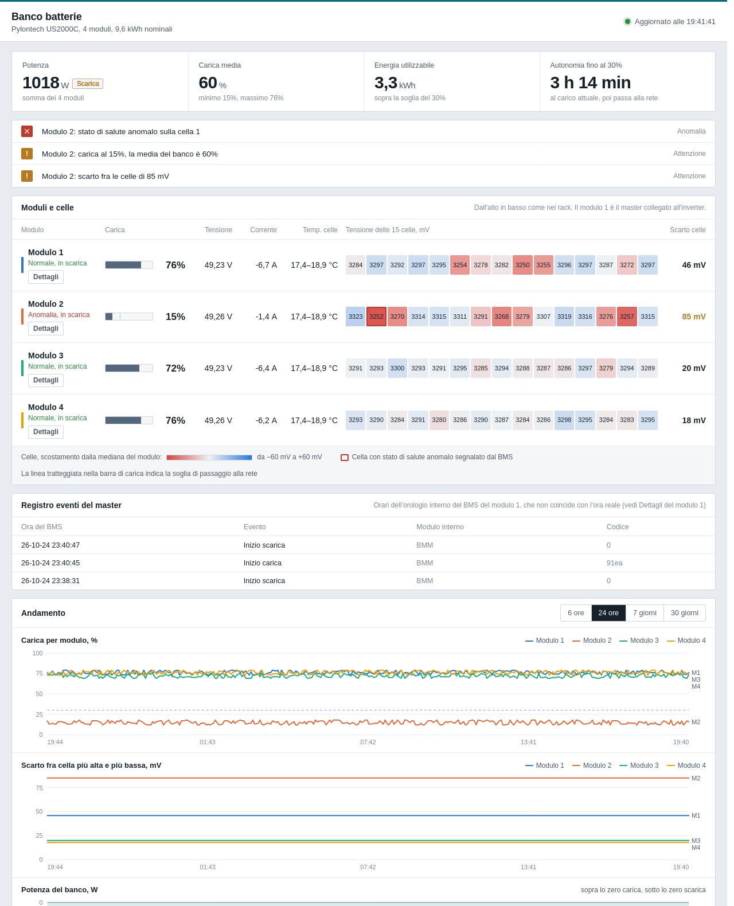
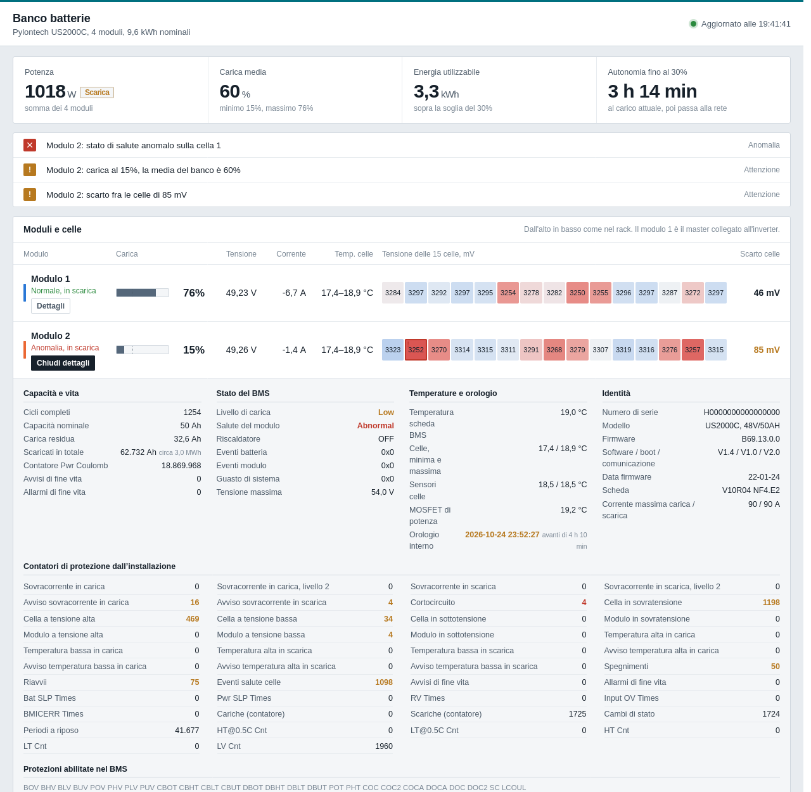

# Pylontech console monitor

[Italiano](README.it.md) | English

A small self-hosted web dashboard for Pylontech battery banks (US2000C, US3000C and similar), read through the RS232 **console port** of the master module. It runs as a single Python script, usually in a Docker container on a Raspberry Pi, and needs no Home Assistant, MQTT broker or extra hardware beyond the console cable.

It was built to answer a practical question: *is one of my modules failing, and which cell?* Besides the usual charge and power values, it reads the per-cell health flags, the protection counters and the event log that the BMS keeps internally.



## Features

- **Bank summary:** power, average state of charge, usable energy above the inverter's grid-switch threshold, estimated runtime or time to full.
- **Rack view:** every module in one row, top to bottom, with charge, voltage, current, cell temperature range and the voltage of all 15 cells, coloured by deviation from the module median.
- **Cell health:** cells flagged as abnormal by the BMS (`soh N`) are marked.
- **Module details** (click *Dettagli*): cycle count, nominal and remaining capacity, total discharged Ah, BMS status and fault codes, board and MOSFET temperatures, BMS clock drift, serial number and firmware, and every protection counter (over-voltage, over-current, short circuit, temperature, shutdowns, SOH events...) with the change over the last 7 days.
- **Event log** of the master module.
- **Alerts** for abnormal cells, BMS states, modules far from the bank average and large cell spreads.
- **History charts** (6 h, 24 h, 7 and 30 days): state of charge per module, cell spread per module, bank power.
- **Light and dark theme**, works on phones.
- Data is stored in plain monthly CSV files; daily snapshots of the protection counters are kept to spot a module that is getting worse.



## Read-only by design

The script only sends read commands to the console:

| Command | Used for | How often |
|---|---|---|
| `pwr` | summary of all modules (charge, voltage, current, temperatures, states, BMS clock) | every cycle (30 s) |
| `bat N` | voltage, temperature, balancing of each cell | every cycle |
| `soh N` | health flag of each cell | every 10 cycles |
| `pwr N`, `stat N` | status, fault codes, capacity, cycle and protection counters | every 20 cycles |
| `info N` | serial number, firmware, board | every 120 cycles |
| `log` | event log of the master (first pages only) | every 20 cycles |

It never sends configuration, time, shutdown, reset, login or update commands.

## Hardware

- A Pylontech **console cable** (RJ45 to USB or RS232), the same one used with Pylontech BatteryView. Plug the RJ45 end into the **CONSOLE** port of the **master** module (the one linked to the inverter).
- Any Linux machine with Python 3 or Docker. Tested on a Raspberry Pi 4 with Debian 12.

Only one program can use the console port at a time: stop the monitor before using BatteryView.

If the console stays silent (for example after a power cut), the script sends the standard 1200 baud wake-up sequence and then switches to 115200 baud.

## Install with Docker

```bash
git clone https://github.com/111blackeagle111/pylontech-console-monitor.git
cd pylontech-console-monitor
cp .env.example .env
```

Edit `.env`:

- `PYLON_DEVICE`: the cable's serial device. Prefer the stable path shown by `ls -l /dev/serial/by-id/`.
- `DIALOUT_GID`: the GID of the host `dialout` group (`getent group dialout`), so the container can open the port without running as root.
- `NOMINAL_AH`: capacity of one module (50 for US2000C, 74 for US3000C).
- `CUTOFF_SOC`: the state of charge at which your inverter switches back to the grid; it is used for the usable energy and runtime estimates.

Then:

```bash
docker compose up -d --build
```

Open `http://<host>:8765`.

## Run without Docker

```bash
pip install pyserial
PYLON_PORT=/dev/ttyUSB0 HOST=0.0.0.0 python3 pylon_monitor.py
```

## Configuration

| Variable | Default | Meaning |
|---|---|---|
| `PYLON_PORT` | `/dev/ttyUSB0` | serial port (inside the container it is `/dev/ttyPylon`) |
| `PYLON_DATA` | script folder | folder for the CSV files (`/data` volume in Docker) |
| `HOST` | `127.0.0.1` | listen address (`0.0.0.0` in Docker) |
| `PORT` | `8765` | web port |
| `INTERVAL` | `30` | seconds between readings |
| `NOMINAL_AH` | `50` | capacity of one module in Ah |
| `CUTOFF_SOC` | `30` | grid-switch threshold of the inverter, % |

## API

| Endpoint | Content |
|---|---|
| `GET /api/latest` | last reading of all modules, details, event log |
| `GET /api/history?hours=24` | down-sampled history (SOC, cell spread, power) |
| `GET /api/stats?days=30` | daily snapshots of the protection counters |

## Data

- `pylontech-YYYY-MM.csv`: one row per module per reading.
- `pylontech-stat-YYYY-MM.csv`: protection counters, once a day.

About 0.8 MB per day for a 4-module bank.

## Security

There is no authentication. Keep it on your local network or behind a VPN (Tailscale, WireGuard) and do not publish the port to the internet.

## Notes

- The interface is in Italian.
- Counter names come from the BMS (`stat N`); the Italian labels are a best-effort translation and the original code is shown on mouse-over.
- The event log is the master's only: the console has no per-module log command.
- The BMS clock is often wrong; the dashboard shows how far off it is.
- Runtime and energy estimates assume equal module capacity and use the average state of charge.

## Disclaimer

Not affiliated with Pylontech. Use at your own risk: the script only reads data, but you are responsible for your installation.

## License

[MIT](LICENSE)
